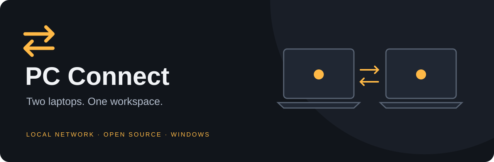
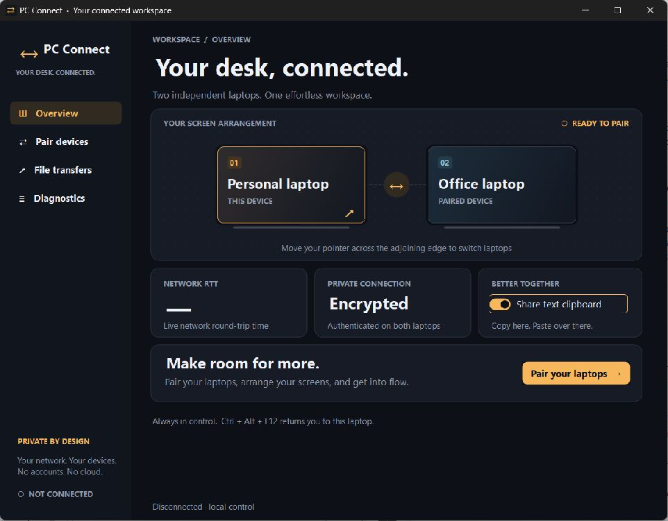

# PC Connect



[](https://github.com/Naveen-145119/PC-Connect/actions/workflows/build.yml)
[](LICENSE)

**One keyboard. One mouse. Two Windows laptops.** PC Connect shares input, text clipboard and files over your local network, with a native Windows interface and no account or cloud relay.

**Experimental preview:** continuous cross-screen copy drag is implemented, including a held-button handoff that passed the local Windows OLE lab. Physical two-laptop qualification is still pending. See [tested behavior and limits](docs/TEST-REPORT.md).

## Download and install

**[Download PC Connect Setup →](https://github.com/Naveen-145119/PC-Connect/releases)**

| Your laptop | Download |
|---|---|
| Intel / AMD Windows | `PCConnect-Setup-win-x64.exe` |
| Windows on ARM / Snapdragon | `PCConnect-Setup-win-arm64.exe` |

Run **one Setup.exe**. It bundles .NET, installs PC Connect for your Windows user, creates desktop and Start menu shortcuts, and appears in Installed apps with an uninstaller. No developer tools or separate runtime are needed.

Prefer a ZIP? Download **PCConnect-Setup-…zip**, extract it, and run the single installer inside. GitHub's automatic **Source code** ZIP is for developers. Optional **Portable** ZIPs run without installation. Release assets include SHA-256 checksums. These preview binaries are unsigned; office installations may require IT approval.

## Connect your personal and office laptops

1. Install the matching release on **both** laptops and connect them to the same trusted LAN.
2. Open **Pair devices**. Choose **Primary** on the laptop whose keyboard/mouse you will use, and **Secondary** on the other. Set its left/right position.
3. Exchange and compare the full device fingerprints. On the primary, enter the secondary's LAN IP.
4. Click **Connect securely** on the secondary first, then the primary. Move across the joining edge to share control.
5. **Ctrl+Alt+F12** returns control. Both applications must remain running.

For a continuous file copy, keep the primary mouse button held while dragging Explorer files to the joining edge. Wait for preparation and verification, then continue into the other Explorer window and release. Originals remain untouched. This preview supports both directions; large files need a wait at the edge.

**[Complete setup and office firewall instructions](docs/SETUP.md)** · [Limitations](docs/LIMITATIONS.md) · [Troubleshooting](docs/SETUP.md#troubleshooting)



## Features

- Native graphite-and-amber interface with device arrangement, pairing, transfers and diagnostics.
- Keyboard/mouse sharing across the two primary displays, automatic reconnect and emergency return.
- Mutually authenticated TLS with manually compared certificate fingerprints; local DPAPI-protected identity.
- Bidirectional plain-text clipboard and file/folder copies, SHA-256 verification and cancellation.
- Separate, paced file channel keeps bulk transfers out of input hooks.
- Continuous held-button cross-screen copy bridge, plus independent panel/inbox transfers.
- Self-contained x64 and ARM64 installers; no background service or permanent input driver.

## Build from source

On Windows x64 with PowerShell and Git:

```powershell
git clone https://github.com/Naveen-145119/PC-Connect.git
cd PC-Connect
.\bootstrap.ps1
.\build.ps1 -Installer
```

The bootstrap verifies the pinned Microsoft .NET SDK archive. Installer builds download and verify the pinned Inno Setup compiler. Outputs go to `outputs/`; generated artifacts, SDKs and local identities are excluded from Git. If PowerShell execution policy prevents scripts, use your organization's approved process.

Use `build.ps1` without `-Installer` to produce portable packages only. See [development and architecture](docs/DEVELOPMENT.md), [contributing](CONTRIBUTING.md), [security](SECURITY.md), [changelog](CHANGELOG.md) and [hardware validation](docs/VALIDATION.md).

## Project layout

```text
src/PCConnect.Core       TLS, protocol, sessions, transfers and drag state
src/PCConnect.App        Native WinForms UI, Win32 input and OLE bridge
tests/PCConnect.Tests    Console regression suite and two-process integration
installer/              Inno Setup application installer
scripts/                Verified installer-tool bootstrap
docs/                   Setup, architecture, limits and validation evidence
.github/                Windows CI, release workflow and issue templates
```

The application uses the .NET platform libraries without third-party NuGet packages. .NET and build tools retain their own licenses. Project source is licensed under [MIT](LICENSE).
